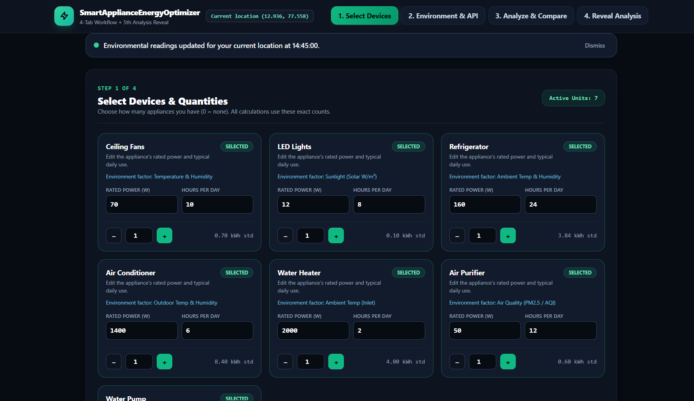
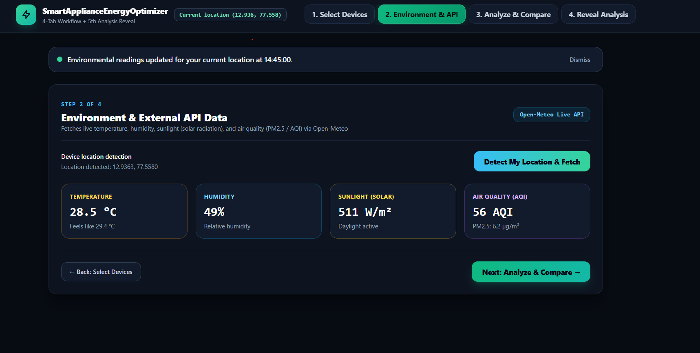
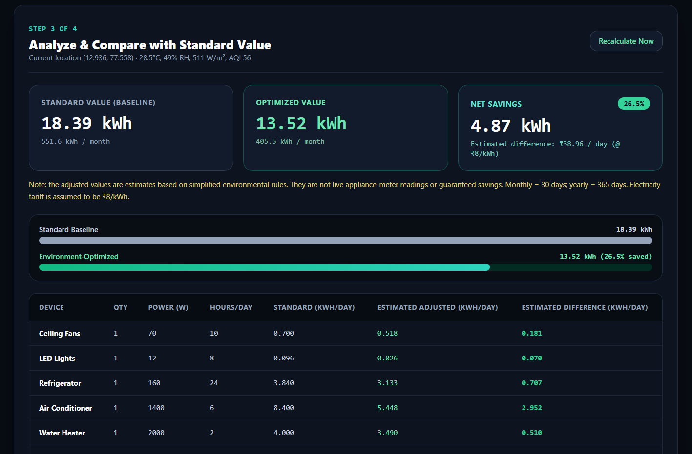
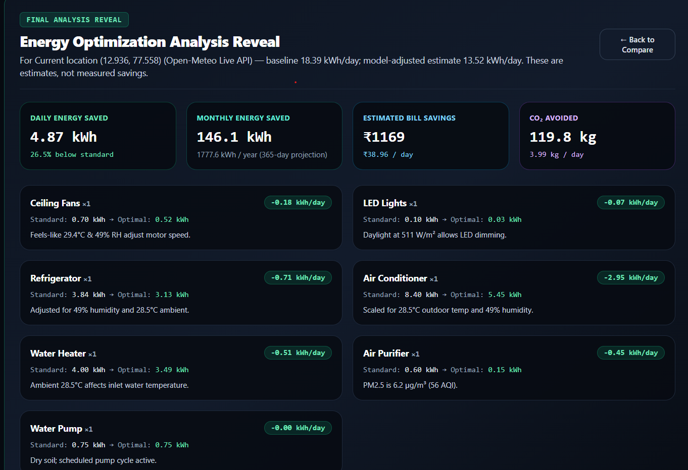

# Smart Appliance Energy Optimizer

An environment-aware smart home energy optimization dashboard that estimates appliance energy consumption using weather conditions and air-quality data.

## Overview

Smart Appliance Energy Optimizer is a web-based application designed to help users understand how environmental conditions can influence household appliance energy consumption.

The application combines appliance information with real-time environmental data to estimate energy usage and provide an environment-aware comparison.

## Features

- **Appliance Management** – Add and manage household appliance quantities.
- **Editable Appliance Settings** – Customize appliance rated power (watts) and daily operating hours.
- **Live Weather Data** – Retrieve temperature, humidity, solar radiation and rainfall information.
- **Air Quality Monitoring** – Retrieve AQI and PM2.5 information.
- **Location Detection** – Use browser location permission to retrieve local environmental data.
- **Energy Estimation** – Estimate appliance energy consumption based on appliance specifications.
- **Environment-Based Comparison** – Compare estimated energy usage under current environmental conditions.
- **Firebase Integration** – Save and retrieve appliance selections using Cloud Firestore.

## Technologies Used

| Technology | Purpose |
|---|---|
| HTML, CSS, JavaScript | Frontend development |
| Node.js | Backend runtime |
| Express.js | Backend API |
| Firebase Admin SDK | Firebase integration |
| Cloud Firestore | Data storage |
| Open-Meteo API | Weather and air-quality data |
| Browser Geolocation API | Current location detection |

## How It Works

1. The user selects household appliances and enters their quantities.
2. Appliance power ratings and daily operating hours can be customized.
3. The browser requests location permission.
4. The application retrieves environmental information using the Open-Meteo APIs.
5. The backend processes the environmental data and provides it to the frontend.
6. The application estimates appliance energy consumption and displays the comparison.
7. Appliance selections are saved and retrieved through Firebase Firestore.

## Energy Calculation

The application uses the following baseline energy consumption formula:

**Energy Consumption (kWh/day)**

`(Quantity × Rated Power (W) × Operating Hours) / 1000`

The environment-based comparison uses estimated adjustment factors based on environmental conditions.

**Note:** The results are model-based estimates, not actual measurements from smart meters or physical appliance sensors. Actual energy consumption depends on appliance efficiency, usage patterns, settings and other conditions.

## Environmental Data

The application retrieves environmental information such as:

- Temperature
- Feels-like temperature
- Relative humidity
- Solar radiation
- Precipitation
- Soil moisture estimate
- Air Quality Index (AQI)
- PM2.5 concentration

Environmental information is retrieved from the Open-Meteo Weather and Air Quality APIs.

## Project Setup

### Prerequisites

Make sure you have installed:

- [Node.js](https://nodejs.org/)
- [Git](https://git-scm.com/)
- A Firebase project with Cloud Firestore enabled

### 1. Clone the Repository

```bash
git clone https://github.com/Sevanth28/Smart-Energy-Optimization.git
```

### 2. Navigate to the Project Folder

```bash
cd Smart-Energy-Optimization
```

### 3. Install Dependencies

```bash
npm install
```

### 4. Configure Firebase

1. Create a Firebase project.
2. Enable Cloud Firestore.
3. Generate a Firebase Admin SDK service account key.
4. Place the downloaded JSON file in the project root.
5. Name it `serviceAccountKey.json`.


### 5. Start the Application

```bash
node server.js
```

### 6. Open the Application

Visit the following address in your browser:

```text
http://localhost:3000
```

Allow location access when prompted to retrieve environmental information for your current location.


## Application Screenshots

## Dashboard


## Environment Monitoring 


## Analysis
 

## Reveal Analysis


## API Endpoints

| Method | Endpoint | Purpose |
|---|---|---|
| GET | `/api/environment` | Retrieves environmental information |
| POST | `/api/save-devices` | Saves appliance selections |
| GET | `/api/load-devices/:sessionId` | Loads saved appliance selections |

## Data and Security

- Firebase is used to store appliance selection data.
- Environmental information is retrieved through the backend.
- Browser location access requires user permission.
- Location coordinates are not stored in Firestore by the application's environment endpoint.
- Firebase service account credentials must remain private.

## Future Enhancements

- Integration with real-time smart energy meters.
- Historical energy consumption analysis.
- Appliance-wise usage reports and visualizations.
- Improved energy prediction models.
- Personalized energy-saving recommendations.

## Author

**Developed by:** Sevanth D

**Project:** Smart Appliance Energy Optimizer

---

If you find this project interesting, consider giving the repository a ⭐ on GitHub!
